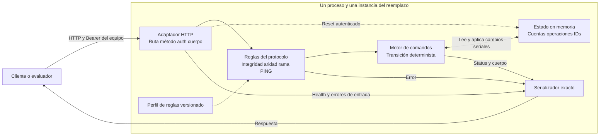
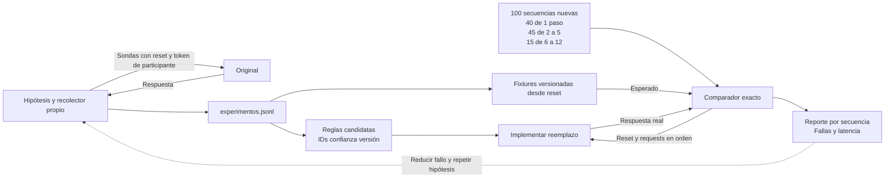

# Arquitectura del reemplazo de Caja Negra

La arquitectura es propuesta. No representa la implementación interna del original.

## Ejecución

## Exploración y pruebas

Durante la evaluación el reemplazo no consulta al original. La validación usa fixtures del original o sondas nuevas fuera del proceso del reemplazo, con reset e identidad independientes.

Decisiones D1 a D6 y objetivos de aceptación: ver 01-diseno-servicio.md.
